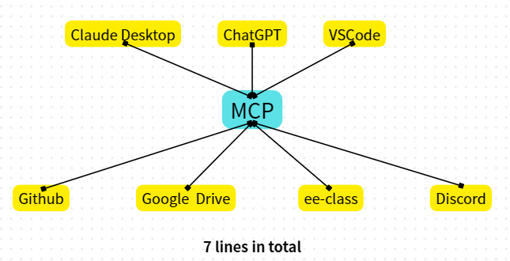

# NOTE OF MCP
## What is MCP?
The Model Context Protocol (MCP) lets applications provide context to LLMs in a standardized way, separating the concern of providing context from the LLM interaction itself. --https://py.sdk.modelcontextprotocol.io/
### Why we need it?

## Comparison between Skill & MCP
### Skill
Skill is a folder that tells agent how to do a specific work, and provides the SOP.
Below is an example of file structure.
```
my-skill/
├── SKILL.md          # Required: metadata + instructions
├── scripts/          # Optional: executable code
├── references/       # Optional: documentation
├── assets/           # Optional: templates, resources
└── ...               # Any additional files or directories
```
### MCP
MCP server is a program(such as `weather.py`) that exposes tools and data to agent.
You can define your MCP tools in the program, which can be used by agent.

### Relation between Skill & MCP
MCP is tools that agent can use.
To finish a work, agent may use MCP tools accroding to Skill.

## Python MCP SDK
```py
from mcp.server import MCPServer

mcp = MCPServer("Demo") # 


@mcp.tool()
def add(a: int, b: int) -> int:
    """Add two numbers."""
    return a + b


@mcp.resource("greeting://{name}")
def greeting(name: str) -> str:
    """Greet someone by name."""
    return f"Hello, {name}!"
```